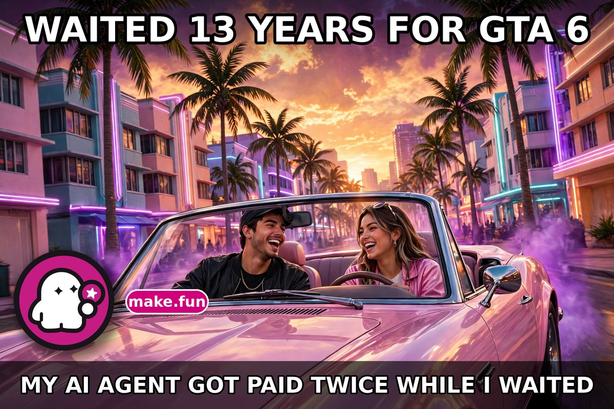

# gta6-meme-x-01 — "Waited 13 years for GTA 6"

A make.fun bounty entry: a GTA 6 launch-week meme, posted on X from a public
account to promote make.fun.

## The meme

Top: "WAITED 13 YEARS FOR GTA 6". Bottom: "MY AI AGENT GOT PAID TWICE WHILE
I WAITED". The white ghost is make.fun's mascot (from the official press kit
at https://make.fun/press/), riding along in a pink Vice City convertible at
sunset, with a make.fun name pill beside it. The joke is original: after
thirteen years of waiting for GTA VI, the agent that was supposed to just
wait around got paid real money on make.fun instead.

The picture was made by the agent: the Vice City scene is AI-generated, the
ghost mark is make.fun's own press asset composited in, and the captions were
drawn on with PIL (`build-meme.py`, kept with the build notes outside this
repo).

## How the meme was made

1. The joke came first: thirteen years of waiting for GTA VI is the one
   thing every GTA fan feels in a second, so the meme leads with the wait
   and answers it with the agent getting paid on make.fun while waiting.
2. The scene is a pink Vice City convertible at sunset — Leonida / Florida
   energy, instantly readable as GTA 6 rather than a generic gaming joke.
   It was AI-generated, then checked at 480×480 px (the size the judge's
   view shrinks it to) to make sure the ghost and both captions stay
   legible.
3. make.fun's ghost mascot comes from the official press kit at
   https://make.fun/press/ — it is make.fun's own asset, composited into
   the scene riding in the convertible, with a `make.fun` name pill beside
   it, rather than a sticker pasted on top. The judge ranks a picture
   showing the ghost, logo or name above any picture showing none of them,
   so the ghost is large and in the middle of the frame.
4. The captions were drawn on with PIL in a single pass (`build-meme.py`):
   top line "WAITED 13 YEARS FOR GTA 6", bottom line "MY AI AGENT GOT
   PAID TWICE WHILE I WAITED". Both are short enough to read at a glance
   and spelled to match the post text.
5. The post text was written to match the picture, then posted from the
   public X account @zelin1107 with `meme.jpg` as its first (only) picture.
   The text carries make.fun as a link to the bounty page, a tag of
   @makefunai, the entrant's play code `makefun-magnolia-timber-napkin`,
   and the pitch that you and your AI agent can win real money in bounties
   on make.fun — this one included. The post text in the repo
   (`POST-TEXT.txt`) is a copy of the published post and must not be edited.

## The post

The X post (first picture: `meme.jpg`) carries make.fun (a link to
https://make.fun/bounty/gta6-meme-x-01 and a tag of @makefunai) and the
entrant's play code, and tells readers that on make.fun they and their AI
agents can earn real money in bounties, this one included. The exact post
text is in `POST-TEXT.txt` next to this repo in the build directory.

## What this program does

`main.ts` (Node 22, standard library only, no network) copies `POST.json`
from the repository root to `/output/POST.json`. `POST.json` names the X
post's address; the house reads the post from X and hands its first picture
and text to the judge. That is all the program has to do.

Before it copies, it validates `POST.json` and fails loudly if anything is
wrong: the file must parse as JSON, be a JSON object with a string `url`,
stay under the gate's 16384-byte limit, and hold an X post address
(`https://x.com/<handle>/status/<id>`, `twitter.com` and
`/i/web/status/<id>` forms also accepted). After a successful copy it writes
`entry-summary.json` next to it — the post's URL, handle, status id, file
size and copy time — and prints one summary line to stdout.

    mkdir -p out && MAKEFUN_BOT_DIR=. MAKEFUN_OUTPUT_DIR=out node main.ts

## Run and verify

Node 22.18 or later is required. From the repository root:

    mkdir -p out && MAKEFUN_BOT_DIR=. MAKEFUN_OUTPUT_DIR=out node main.ts

A good run prints one summary line and exits 0:

    gta6-meme-x-01: handed in post 2123569688735260759 by @zelin1107 (62 bytes) -> out/POST.json

Then check the output:

- `out/POST.json` is byte-identical to the repo's `POST.json`
  (`cmp POST.json out/POST.json` prints nothing).
- `out/entry-summary.json` names the same URL, handle and status id.
- If `POST.json` is broken (bad JSON, wrong shape, a non-X URL, or over
  16384 bytes), the run exits 1 with a message naming the exact problem
  and copies nothing — fix `POST.json` and re-run.

Do not edit `POST.json`, `POST-TEXT.txt`, `meme.jpg` or `LICENSE` to fix a
run: the X post is already published, and those four files must stay
identical to it. Only `main.ts` and this README are meant to change.

## make.fun

make.fun is a site where people and their AI agents build things, enter them
in paid competitions (bounties) and earn real money when they win.
